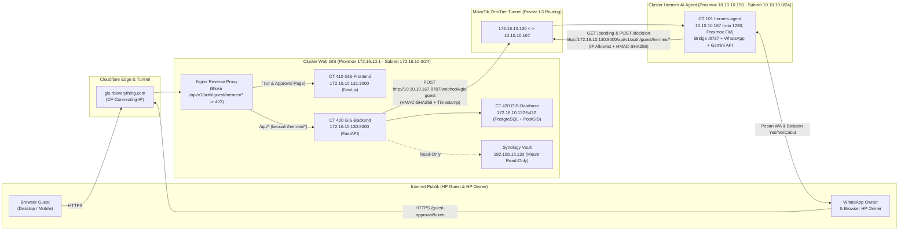
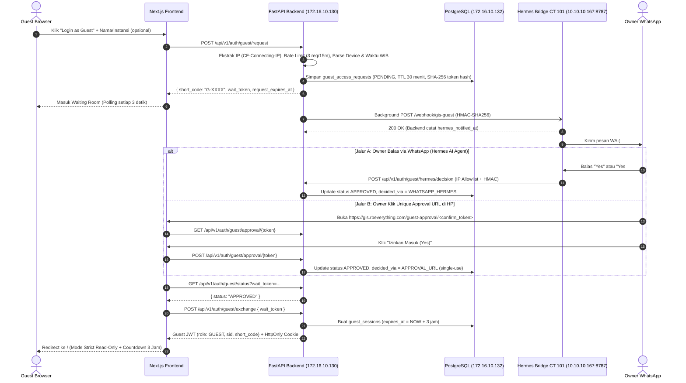

# Blueprint Arsitektur: Just-in-Time (JIT) Guest Access Approval via Hermes AI Agent (WhatsApp) & Strict Read-Only PDF Viewer

Dokumen ini mendefinisikan arsitektur teknis, topologi jaringan privat ZeroTier, skema database, kontrol keamanan berlapis, serta alur integrasi end-to-end untuk fitur **JIT Guest Access Approval** melalui **Hermes AI Agent (RBot / WhatsApp)** dan **Strict Read-Only Canvas PDF Viewer** pada Sistem Web GIS Digitalisasi Tanah LDKH (`https://gis.rbeverything.com/`).

---

## 1. Hasil Audit Infrastruktur & Komponen Eksisting

Berdasarkan audit langsung pada repositori `rb-gis` dan konfigurasi deployment produksi Proxmox VE:

| Komponen | Lokasi / Kode Sumber | Kondisi Eksisting | Kebutuhan Penyesuaian Enhancement |
| :--- | :--- | :--- | :--- |
| **Backend FastAPI** | `backend/app/main.py`, `infra/proxmox/systemd/ldkh-backend.service` | Berjalan dengan Uvicorn di port **`8000`** (`0.0.0.0:8000`, `--workers 2`, `--proxy-headers`). Middleware `reverse_proxy_guard_middleware` mengizinkan trafik hanya dari `TRUSTED_PROXY_IPS` (`127.0.0.1`, `::1`, `172.16.10.133`, `172.16.10.131`) atau header `x-forwarded-by-nginx: true`. | Izinkan trafik langsung via ZeroTier dari `HERMES_ALLOWED_IPS` (`10.10.10.167`) khusus rute `/api/v1/auth/guest/hermes/*`, dan tolak jika melewati Nginx publik. |
| **Autentikasi & RBAC** | `backend/app/core/security.py`, `backend/app/models/enums.py` | Menggunakan JWT HS256 (`scope: "ldkh:auth"`) via `Authorization: Bearer` dan cookie `HttpOnly` bernama `ldkh_access_token`. Role eksisting: `ADMIN`, `AUDITOR`, `VIEWER`. Beberapa endpoint mutasi masih memakai `require_editor` (`AUDITOR` + `ADMIN`). | Tambahkan role `GUEST` pada `UserRole`, validasi tabel `guest_sessions` (3 jam + cek `revoked_at`) di `get_current_user` (kembalikan `401 GUEST_SESSION_EXPIRED`), dan kunci **seluruh** endpoint mutasi (`POST/PUT/PATCH/DELETE`) ke `require_admin`. |
| **Nginx Reverse Proxy** | `infra/proxmox/nginx/nginx.conf`, `infra/nginx/nginx.conf` | Nginx CT Nginx (`172.16.10.133`) menerima trafik dari Cloudflare Tunnel (`cloudflared`) dan meneruskan `/api/` -> `172.16.10.130:8000`, `/` -> `172.16.10.131:3000`, serta `/internal-pdf/` via `X-Accel-Redirect`. | Tambahkan blok `location ^~ /api/v1/auth/guest/hermes/ { return 403; }` sebelum `location /api/` agar endpoint internal Hermes tidak dapat diakses dari internet publik, serta perketat header cache/inline `/internal-pdf/`. |
| **Streaming PDF** | `backend/app/api/endpoints/files.py`, `backend/app/core/pdf_security.py` | Menggunakan short-lived signed JWT (`scope: "pdf:stream"`) dengan header `Content-Disposition: inline` dan `Cache-Control: private, no-store`. | Tambahkan header lengkap `Cache-Control: no-store, no-cache, must-revalidate, private`, `Pragma: no-cache`, dan `X-Content-Type-Options: nosniff` di seluruh jalur respons (`accel`, `FileResponse`, fallback), serta pastikan tidak ada eksposur path `/mnt/...`. |
| **Frontend Login & UI** | `frontend/src/components/auth/LoginPage.tsx`, `Dashboard.tsx` | Halaman login dirender di `Dashboard.tsx` saat `!currentUser` (belum ada route `/login` khusus maupun `/guest-approval/[token]`). | Tambahkan tombol **Login as Guest**, dialog permintaan akses, **Waiting Room** (polling 3 detik + auto-redirect 5 detik saat ditolak/expired), route `/login` & `/guest-approval/[token]`, mode strict read-only, serta banner countdown 3 jam di desktop & mobile. |
| **Frontend PDF Viewer** | `frontend/src/components/pdf/DocumentViewerPanel.tsx` | Merender `<iframe src={pdfUrl} />` untuk semua role; toolbar bawaan browser menampilkan tombol Download & Print. `pdfjs-dist` v3.11.174 & `/pdf.worker.min.js` sudah terpasang di proyek. | Khusus `role === "GUEST"`, ganti `<iframe>` dengan **Canvas PDF Viewer** (`pdfjs-dist`) ber-watermark diagonal, tanpa tombol Download/Print, blokir klik kanan & `Ctrl/Cmd+S/P`, serta proteksi `@media print`. |

---

## 2. Topologi Jaringan & Routing Komunikasi Privat ZeroTier

Kedua cluster Proxmox terhubung secara privat melalui **ZeroTier Tunnel yang dirutekan di MikroTik**, sehingga komunikasi server-to-server **GIS Backend <-> Hermes Bridge** berjalan langsung melalui IP privat tanpa melewati internet publik ataupun Cloudflare Tunnel.

### Aturan Routing Komunikasi

1. **GIS -> Hermes (Direct Push via ZeroTier):**
   - `CT 400` (`172.16.10.130`) mengirim webhook `POST` langsung ke `http://10.10.10.167:8787/webhook/gis-guest` (timeout 6 detik, retry 2x backoff 2 detik) dengan header `X-Hermes-Timestamp` dan `X-Hermes-Signature`.
2. **Hermes -> GIS (Callback Keputusan & Recovery via ZeroTier):**
   - `CT 101` (`10.10.10.167`) memanggil langsung IP privat backend:
     - `GET http://172.16.10.130:8000/api/v1/auth/guest/hermes/pending`
     - `POST http://172.16.10.130:8000/api/v1/auth/guest/hermes/decision`
3. **Unique Approval URL (Untuk Dibuka Owner di HP):**
   - Menggunakan domain publik `https://gis.rbeverything.com/guest-approval/<confirm_token>`.
4. **Blokir Publik di Nginx:**
   - Rute `/api/v1/auth/guest/hermes/*` diblokir permanen (`403 Forbidden`) pada Nginx publik sehingga tidak pernah terekspos ke Cloudflare Tunnel / internet publik.

---

## 3. Alur Sekuensial Just-in-Time (JIT) Guest Access

---

## 4. Skema Database (`guest_access_requests` & `guest_sessions`)

1. **`guest_access_requests`:**
   - `id` (`UUID` PK)
   - `short_code` (`VARCHAR(12)`, unique, format `G-XXXX`, huruf kapital tanpa karakter ambigu `O/0/I/1`)
   - `confirm_token_hash` (`VARCHAR(64)`, unique — SHA-256 dari `confirm_token` 256-bit)
   - `wait_token_hash` (`VARCHAR(64)`, unique — SHA-256 dari `wait_token` 256-bit)
   - `guest_name` (`VARCHAR(100)`, nullable)
   - `ip_address` (`VARCHAR(64)`, not null)
   - `user_agent` (`TEXT`, not null)
   - `device_summary` (`VARCHAR(160)`, not null)
   - `status` (`VARCHAR(24)`: `PENDING`, `APPROVED`, `REJECTED`, `EXPIRED`, `REVOKED`)
   - `requested_at` (`TIMESTAMPTZ`, default `NOW()`)
   - `request_expires_at` (`TIMESTAMPTZ` — `requested_at + 30 menit`)
   - `decided_at` (`TIMESTAMPTZ`, nullable)
   - `decided_via` (`VARCHAR(32)`, nullable — `WHATSAPP_HERMES` / `APPROVAL_URL`)
   - `hermes_notified_at` (`TIMESTAMPTZ`, nullable)

2. **`guest_sessions`:**
   - `id` (`UUID` PK — claim `sid` di JWT)
   - `request_id` (`UUID` FK -> `guest_access_requests.id`, unique)
   - `ip_address` (`VARCHAR(64)`)
   - `device_summary` (`VARCHAR(160)`)
   - `started_at` (`TIMESTAMPTZ`)
   - `expires_at` (`TIMESTAMPTZ` — `started_at + 3 jam`)
   - `revoked_at` (`TIMESTAMPTZ`, nullable)

---

## 5. Matriks Kontrol Keamanan Berlapis

| Layer Keamanan | Mekanisme Implementasi | Efek Penolakan |
| :--- | :--- | :--- |
| **Deteksi IP Publik Asli** | Prioritas `CF-Connecting-IP` -> `X-Forwarded-For` (IP pertama) -> `X-Real-IP` -> `request.client.host`. | Mencegah spoofing/akumulasi rate limit ke IP proxy Nginx. |
| **Anti-Spam Request** | Rate limiter sliding window: maks. **3 permintaan / IP / 15 menit** pada `POST /api/v1/auth/guest/request`. | `429 Too Many Requests` (Bahasa Indonesia). |
| **Isolasi Rute Hermes (Nginx)** | `location ^~ /api/v1/auth/guest/hermes/ { return 403; }` pada server block publik Nginx. | `403 Forbidden` dari internet publik / Cloudflare Tunnel. |
| **Double-Layer Hermes Verification** | 1) Cek `request.client.host` terhadap `HERMES_ALLOWED_IPS` (`10.10.10.167`) + tolak header proxy publik; 2) Validasi `X-Hermes-Timestamp` (maks selisih `<= 300` detik) & `X-Hermes-Signature` (`HMAC_SHA256(HERMES_SHARED_SECRET, f"{timestamp}.{raw_body}")`). | `403 Forbidden` (IP tidak diizinkan) / `401 Unauthorized` (Signature/Timestamp tidak valid). |
| **TTL & Single-Use Token** | Permintaan hangus otomatis setelah **30 menit** (`EXPIRED`). `confirm_token` & `wait_token` hanya dapat ditukar 1x (*single-use*). | `410 Gone` / `409 Conflict`. |
| **Session Expiry & Revoke** | `get_current_user` memeriksa `guest_sessions` (`revoked_at IS NULL` dan `NOW() < expires_at`) pada setiap request `GUEST`. | `401 Unauthorized` dengan kode `GUEST_SESSION_EXPIRED`. |
| **Strict Read-Only RBAC** | Seluruh endpoint mutasi (`POST`, `PUT`, `PATCH`, `DELETE` untuk parcels, documents, owners, upload PDF, import, OCR) dikunci dengan `require_admin`. | `403 Forbidden` untuk role `GUEST`. |
| **PDF Stream & Canvas Viewer** | Header `Content-Disposition: inline`, `Cache-Control: no-store, no-cache, must-revalidate, private`, `Pragma: no-cache`, `X-Content-Type-Options: nosniff`. UI Guest merender via `<canvas>` (`pdfjs-dist`), watermark diagonal dinamis, tanpa tombol Download/Print, blokir klik kanan & `Ctrl/Cmd+S/P`, serta `@media print`. | Mengurangi risiko unduh/cetak dokumen legal secara langsung oleh Guest. |
